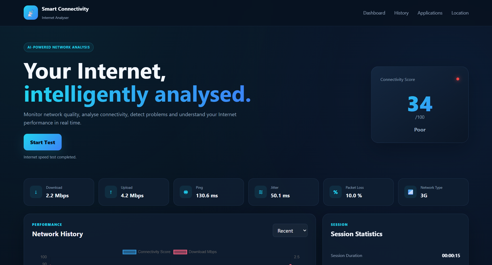
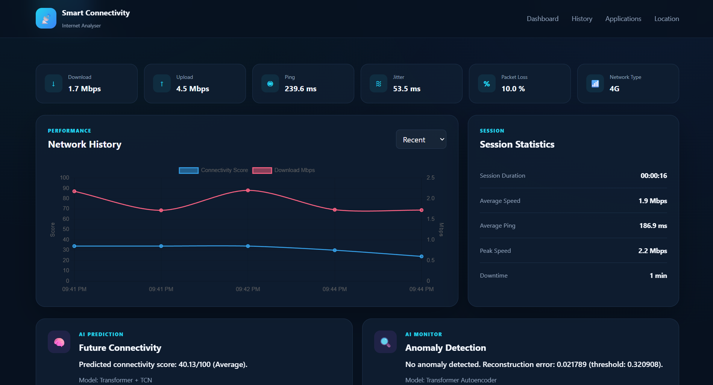
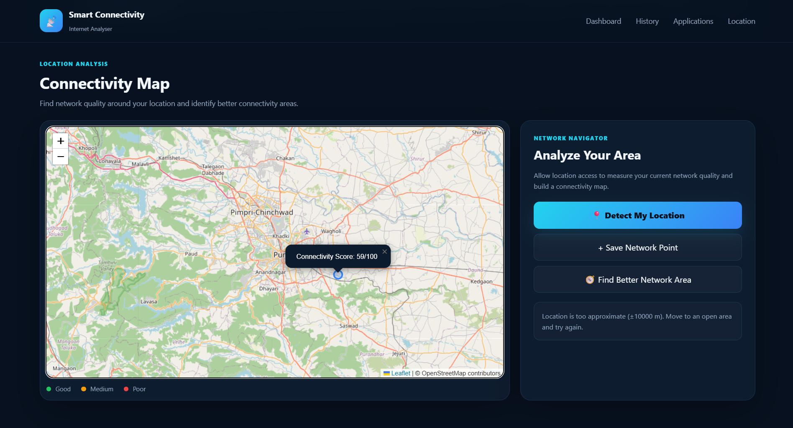
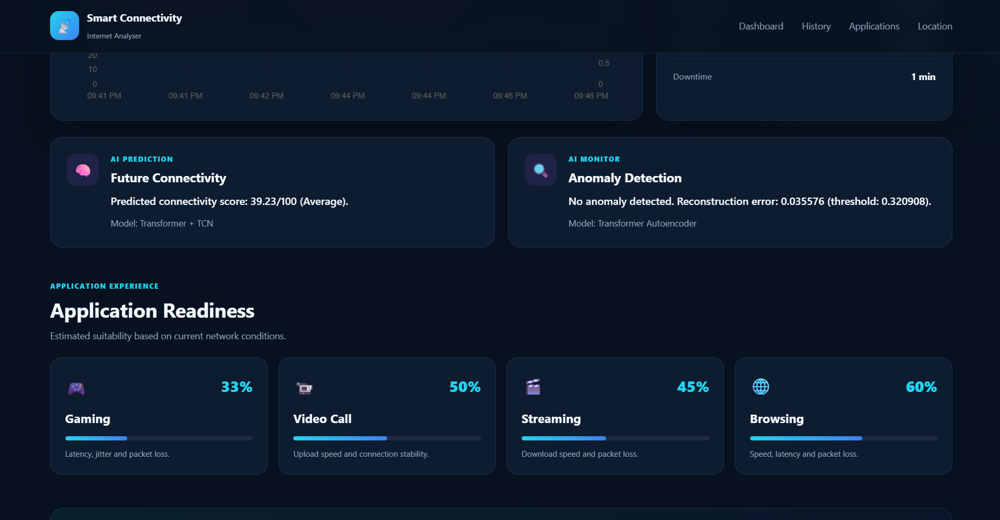
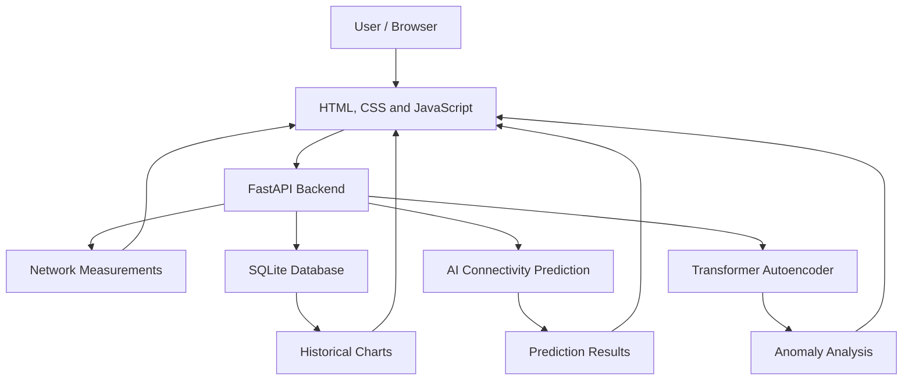

# 🌐 Smart Internet Connectivity Analyser

<p align="center">
  <strong>Monitor • Analyse • Predict • Improve</strong>
</p>

<p align="center">
  A web application for monitoring internet connectivity, analysing network performance, visualising historical measurements, and exploring experimental AI-powered analysis.
</p>

<p align="center">
  <a href="https://smart-connectivity-analyser.onrender.com/">
    
  </a>
  <a href="https://github.com/saurabhwagh01/smart-connectivity-analyser">
    
  </a>
  
</p>

---

## 📌 About the Project

**Smart Internet Connectivity Analyser** is a web-based application designed to help users understand their internet connection through network measurements, historical performance charts, geographical visualisation, and machine-learning-based analysis.

The application combines a web frontend with a FastAPI backend and SQLite storage for network test records. It also includes AI components for connectivity prediction and anomaly detection.

### 💡 Why This Project Matters

Internet connectivity can vary because of network congestion, signal conditions, and other factors. This project brings network measurements, historical records, visualisations, and experimental AI analysis together in one dashboard to make network performance easier to understand.

## ✨ Features

- 📡 **Network Monitoring:** Measure and display supported network metrics such as download speed, upload speed, ping, jitter, and packet loss.
- 📊 **Performance Dashboard:** View network metrics and a connectivity score.
- 📈 **Network History:** Store test records and visualise performance trends.
- 🗺️ **Connectivity Map:** Explore geographical visualisation using Leaflet and OpenStreetMap.
- 🤖 **AI Connectivity Prediction:** Estimate connectivity quality using the project's prediction component.
- 🔍 **Anomaly Detection:** Use a Transformer Autoencoder to calculate reconstruction errors and flag records that exceed a configured threshold.
- 🗄️ **Data Persistence:** Store supported network test records in an SQLite database.
- ⚡ **REST API:** Access network measurements, history, prediction, and anomaly analysis through FastAPI endpoints.
- ♿ **Accessibility:** Use the dashboard with a keyboard, labelled controls, visible focus indicators, accessible charts and progress indicators, and screen-reader announcements for status and error messages.

> **AI limitations:** Prediction and anomaly detection are experimental. Their performance must be evaluated on suitable test data. Anomaly detection requires validation against labelled normal and anomalous examples. Results may be unavailable when there are not enough complete records.

## 🖥️ Application Screenshots

Save screenshots in the `screenshots/` directory using these exact filenames. Remove any image entry until its file exists.

### Dashboard



### Network History



### Connectivity Map



### AI Analysis



## 🛠️ Technology Stack

| Category | Technologies |
|---|---|
| Frontend | HTML, CSS, JavaScript |
| Backend | Python, FastAPI |
| Database | SQLite |
| Machine Learning | scikit-learn, PyTorch |
| Data Visualisation | Chart.js |
| Mapping | Leaflet, OpenStreetMap |
| Server | Uvicorn |
| Deployment | Render |
| Version Control | Git, GitHub |

## 🏗️ Architecture



### 🔄 How It Works

1. The user opens the application and runs a network test.
2. The frontend communicates with the backend where required.
3. Supported test records are stored in SQLite.
4. Historical records are retrieved for dashboard charts.
5. AI components process available network data when sufficient complete records are available.
6. The frontend displays the available results.

## 📋 Prerequisites

Before running the project locally, make sure you have:

- Python compatible with the dependencies listed in `requirements.txt`.
- pip, the Python package installer.
- Git.
- Node.js 18 or newer for JavaScript tests and the complete Python test suite.
- A modern web browser.
- Visual Studio Code or another code editor (VS Code Live Server is recommended for the frontend).

**Python compatibility:** PyTorch and other dependencies may have operating-system and Python-version requirements. If installation fails, check the dependency versions and use a supported Python environment.

## 🚀 Getting Started

### 1. Clone the Repository

```bash
git clone https://github.com/saurabhwagh01/smart-connectivity-analyser.git
cd smart-connectivity-analyser
```

### 2. Set Up the Python Environment

Create a virtual environment before installing dependencies.

**Windows PowerShell:**

```powershell
python -m venv .venv
.\.venv\Scripts\Activate.ps1
```

If PowerShell blocks activation, use the virtual environment's Python executable directly for subsequent commands.

**macOS / Linux:**

```bash
python3 -m venv .venv
source .venv/bin/activate
```

### 3. Install Backend Dependencies

From the project root, run:

```bash
python -m pip install -r requirements.txt
```

If you are using the Windows activation fallback, run:

```powershell
.\.venv\Scripts\python.exe -m pip install -r requirements.txt
```

### 4. Start the Backend

From the project root, run:

```bash
python -m uvicorn backend.main:app --reload
```

If PowerShell activation is blocked, use the virtual environment's Python executable:

```powershell
.\.venv\Scripts\python.exe -m uvicorn backend.main:app --reload
```

The FastAPI backend should now be available at:

- **API health check:** [http://127.0.0.1:8000/api/health](http://127.0.0.1:8000/api/health)
- **Interactive API documentation:** [http://127.0.0.1:8000/docs](http://127.0.0.1:8000/docs)

Keep the backend terminal running while using the frontend.

### 5. Open the Frontend

The frontend is a static web application.

1. Open the project folder in Visual Studio Code.
2. Open `index.html`.
3. Start the page using the VS Code Live Server extension.
4. Open the local URL provided by Live Server in your browser.

The frontend and backend may run on different local ports.

**API configuration:** By default, the frontend sends API requests to:

```text
http://127.0.0.1:8000/api
```

The API base URL can be overridden by setting `window.API_BASE` before `js/script.js` loads.

Make sure the backend is running before using frontend features that require API requests.

**AI features:** Predictions and anomaly analysis may require the expected model files and sufficient complete network records. Check the AI status endpoint if these features are unavailable.

## 🔌 API Endpoints

| Method | Endpoint | Description |
|---|---|---|
| GET | `/api/health` | Check backend health |
| GET | `/api/health/live` | Check that the API process is responding |
| GET | `/api/health/ready` | Check whether required dependencies are available |
| GET | `/api/ping` | Check basic API connectivity |
| GET | `/api/network-quality` | Measure network quality using the backend ping test |
| GET | `/api/dns-check` | Check whether the backend server can resolve a fixed hostname |
| GET | `/api/network-protocols` | Check IPv4 and IPv6 connectivity independently |

| GET | `/api/diagnostic-profiles` | List the available diagnostic profiles |
| GET | `/api/network-quality` | Measure network quality using the backend ping test. Optional `?profile=<id>` runs a diagnostic profile |
| POST | `/api/network-test` | Submit/save a network test record |
| GET | `/api/network-history` | Retrieve historical network records |
| DELETE | `/api/network-history` | Delete saved network history |

Network history can be deleted by record IDs with `DELETE /api/network-history` and a JSON body such as `{"ids":[1,2]}`. Deleting everything requires the explicit `?all=true` query parameter. The dashboard confirms either destructive action before sending it. Expired records are pruned in batches of at most 500 when a new measurement is saved; the default retention period is 365 days and can be configured with `NETWORK_HISTORY_RETENTION_DAYS` (1–3650 days).
| GET | `/api/ai/status` | Check AI model status |
| GET | `/api/ai/prediction` | Request a connectivity prediction |
| GET | `/api/ai/anomaly` | Analyse the latest complete record for anomalies |
| GET | `/api/ai/analyze` | Request combined AI analysis |

For request schemas and interactive endpoint testing, open `/docs` while the local backend is running.

`/api/health/live` returns `200 {"status":"alive"}` while the API process is running. `/api/health/ready` returns `200` when the existing SQLite history database is usable and `503` when it is not; its response contains `checks.database` and `optional.ai_models`. AI model availability is reported but does not change the status code, and neither endpoint runs network tests or model training.

`GET /api/dns-check` reports whether the backend server can resolve a fixed public hostname and the lookup duration when available. The dashboard shows success, timeout, and resolver failure states alongside the network measurements. This diagnostic describes the backend host's resolver; it does not test the browser device's DNS settings.
`GET /api/network-protocols` reports a top-level `connected` flag and independent `ipv4` and `ipv6` results for the backend server's outbound network. Each protocol has a `status` of `available`, `unavailable`, or `unsupported`; unavailable results use a safe `reason` such as `dns_failure`, `timeout`, or `connection_failure`. The check uses a fixed hostname and HTTPS port, and it does not change the existing `/api/network-quality` response. This is a reachability probe for the backend host; it does not verify every destination or measure the browser device's ISP route.

`POST /api/network-test` validates its input and returns `422` with details for invalid requests:

- At least one measurement (`download_mbps`, `upload_mbps`, `ping_ms`, `jitter_ms`, `packet_loss`, `connectivity_score`) is required. Any unavailable measurement may be `null`.
- Speeds, ping, and jitter must not be negative. `packet_loss` and `connectivity_score` must be between 0 and 100.
- `NaN`, `Infinity`, and boolean values are rejected.
- `timestamp` must be an ISO 8601 date-time. If it is omitted, the current server time is used.

**Timestamps:** records are stored in one canonical UTC form, the format of JavaScript's `toISOString()` (for example `2026-11-02T04:30:00.000Z`). A timestamp with an offset such as `+05:30` is converted to the same instant in UTC. A timestamp without `Z` or an offset is read as the server's local time, which is how older versions of the backend stored records. `GET /api/network-history` returns timestamps in the same UTC form, filters `range`, `start_date` and `end_date` by UTC instant (dates are UTC calendar days), and orders records by UTC instant, then by `id`. Existing records are never rewritten; a stored value that is not a valid date-time is still returned as stored, after all other records, but is left out of time filters and AI training data. The logic lives in `backend/timestamps.py`.
- `latitude` (-90 to 90) and `longitude` (-180 to 180) must be provided together.
- `network_type` is limited to 50 characters.

> ⚠️ **Caution:** The history deletion endpoint can permanently remove saved network history. Use it only when you intentionally want to clear the records.

## 🤖 AI Components
## 🩺 Diagnostic Profiles

Choose how deep a network test goes. The profile definitions live in one
validated config (`backend/diagnostic_profiles.py`) and are served to the
frontend by `GET /api/diagnostic-profiles`, so the frontend and backend always
agree on which measurements run.

| Profile | Purpose | Checks | Approx. time |
|---|---|---|---|
| Standard Test *(default)* | The original test, unchanged | Ping, jitter, packet loss, download, upload | Varies |
| `quick`: Quick Check | Fast status check | Latency (ping), packet loss | ~5 s |
| `detailed`: Detailed Diagnosis | Deeper investigation | Ping, jitter, packet loss, download, upload | ~40 s |
| `stability`: Stability Test | Consistency over a longer run | Ping, jitter, packet loss (40 packets) | ~45 s |

Download and upload speeds are measured in the browser (Cloudflare speed
test). The other checks are measured by the backend ping command.

**Using a profile:** `GET /api/network-quality?profile=quick`. Without the
`profile` parameter the endpoint behaves exactly as before, so existing callers
keep working. An unknown profile returns `400` with the list of valid profile
ids.

Each check in a profile response reports `ok` or `failed` (or `client_side` for
checks the browser measures). A failed check returns `null` instead of a made-up
value, and every response includes `measured_at`, so old or simulated numbers are
never shown as fresh results.
### Connectivity Prediction

The application includes a HistGradientBoosting-based prediction component that estimates connectivity quality from available network data. Predictions depend on the available training records and input completeness, so treat them as estimates rather than guaranteed future performance.

### Anomaly Detection

The application includes a Transformer Autoencoder that reconstructs network measurements and calculates a reconstruction error. The error is compared with a configured threshold to flag potentially unusual records.

The detector has not yet been fully validated against labelled normal and anomalous examples. Threshold calibration and reproducible evaluation remain important areas for improvement.

## 🧪 Testing and Verification

The project includes Python tests, JavaScript frontend unit tests, and Playwright browser tests. Run the relevant test suites after making changes.

### 1. Python Backend Tests

Install the development dependencies from the project root:

```bash
python -m pip install -r requirements-dev.txt
```

Run the complete Python test suite:

```bash
python -m pytest tests
```

To run an individual test file:

```bash
python -m pytest tests/test_network_test_validation.py
```

**Note:** The complete Python test suite also includes a wrapper that executes the JavaScript metric-formatting tests. Node.js must therefore be available when running the complete suite.

### 2. JavaScript Frontend Unit Tests

Node.js 18 or newer is required. These tests use Node.js's built-in test runner and do not require additional npm packages.

Run all default frontend unit tests from the project root:

```bash
npm test
```

This runs the following test files:

- `tests/connectivity-score.test.js`
- `tests/metric_formatting.test.js`
- `tests/history-filters.test.js`

To run an individual test file:

```bash
node --test tests/connectivity-score.test.js
node --test tests/metric_formatting.test.js
node --test tests/history-filters.test.js
```

### 3. Playwright Browser Tests

Browser scenario tests use Playwright and Chromium. They cover dashboard empty states, API errors, populated history, and AI fallback behaviour.

Install Playwright and its Chromium browser:

```bash
npm install --no-save playwright
npx playwright install chromium
```

Run the browser tests:

```bash
npm run test:browser
```

On Linux systems that need additional browser dependencies, use:

```bash
npx playwright install --with-deps chromium
```

### 4. Manual Verification

When applicable, verify the following before submitting changes:

- Start the backend and check `/api/health`.
- Verify that network test records can be saved and retrieved.
- Check that historical charts display available records.
- Test AI endpoints with sufficient complete records.
- Confirm that unavailable measurements are not silently treated as real zero values.
- Check browser developer tools and backend output for errors.

For research or performance claims, use a reproducible test split and suitable baseline methods. Report only metrics that have actually been measured.

## 📁 Project Structure

```text
smart-connectivity-analyser/
├── backend/
│   ├── main.py
│   ├── ai_engine.py
│   ├── evaluate_ai.py
│   ├── final_predictor.py
│   └── models/
├── css/
├── js/
├── screenshots/
│   ├── dashboard.png
│   ├── network-history.png
│   ├── connectivity-map.png
│   └── ai-analysis.png
├── tests/
│   ├── metric_formatting.test.js
│   └── test_frontend_metric_formatting.py
├── index.html
├── package.json
├── requirements.txt
├── requirements-dev.txt
├── README.md
└── CONTRIBUTING.md
```

This is an overview of the main project files; your repository may contain additional files and folders.

The SQLite database and trained model files may be created or updated during local use. Keep private network history, credentials, local environment files, and unnecessary generated artifacts out of version control. Check the repository's ignore rules before committing local data.

## 🔮 Future Improvements

- Improve prediction evaluation using reproducible experiments and baseline comparisons.
- Calibrate the anomaly threshold using suitable validation data.
- Add labelled anomaly examples and report precision, recall, and F1-score when labels are available.
- Improve frontend loading states and error handling.
- Add automated tests for API endpoints and frontend interactions.
- Improve setup documentation and contributor onboarding.
- Explore additional network diagnostics and recommendations.
- Document data sources, data-processing steps, and limitations for research reproducibility.

## 🤝 Contributing

Contributions from beginners and experienced developers are welcome!

You can contribute to frontend development, backend functionality, machine-learning evaluation, testing, bug fixes, and documentation.

1. Read [CONTRIBUTING.md](CONTRIBUTING.md) for contribution guidelines.
2. Explore the [open GitHub Issues](https://github.com/saurabhwagh01/smart-connectivity-analyser/issues).
3. Choose an issue that matches your skills and interests.
4. Read the issue description and acceptance criteria carefully.
5. Ask questions in the issue discussion if anything is unclear.
6. Follow the issue assignment process when required.
7. Submit a pull request describing your changes and tests.

Please keep changes focused and avoid committing private data, secrets, or unrelated generated files.

## 📄 License

Check whether a `LICENSE` file exists in the repository before reusing or redistributing this project. If the repository has no license, do not assume that it grants permission to reuse or redistribute the code. Choose and add a license only after deciding the terms under which you want others to use the project.

## 👨‍💻 Author

**Saurabh Wagh**

- GitHub: [@saurabhwagh01](https://github.com/saurabhwagh01)

---

<p align="center">
  Built to make internet connectivity easier to understand through data, visualisation, and AI.
</p>

<p align="center">
  🚀 <a href="https://smart-connectivity-analyser.onrender.com/">Try the Live Application</a>
</p>
