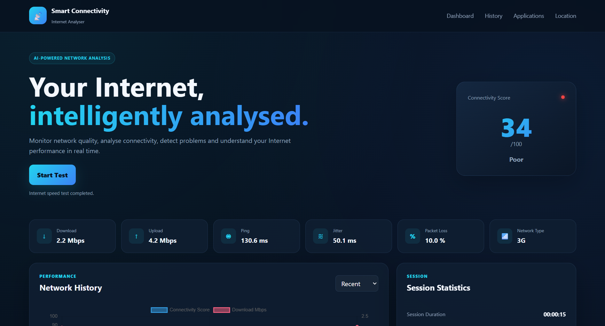
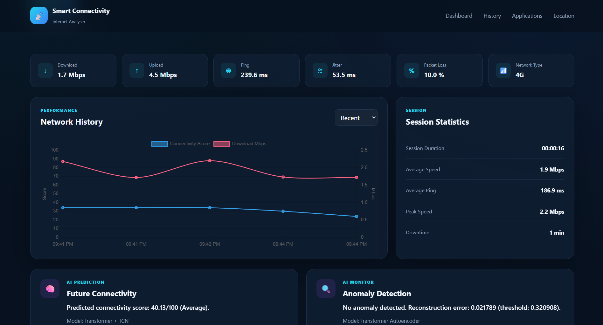
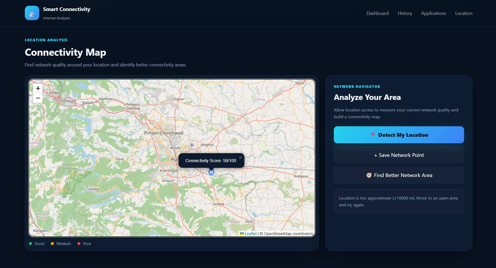
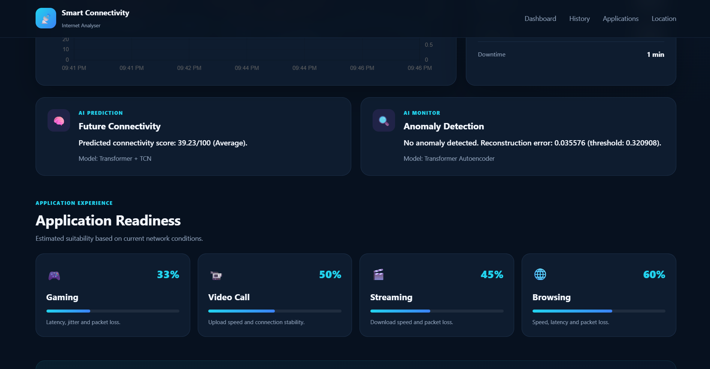
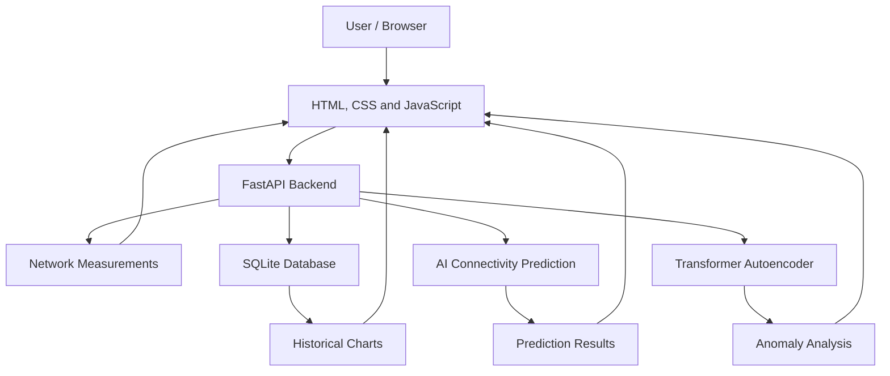

# 🌐 Smart Internet Connectivity Analyser

<p align="center">
  <strong>Monitor • Analyse • Predict • Improve</strong>
</p>

<p align="center">
  A web application for monitoring internet connectivity, analysing network performance, visualising historical measurements, and exploring experimental AI-powered analysis.
</p>

<p align="center">
  <a href="https://smart-connectivity-analyser.onrender.com/">🚀 Live Demo</a>
</p>

---

## 📌 About the Project

**Smart Internet Connectivity Analyser** is a web-based application designed to help users understand their internet connection through network measurements, historical performance charts, geographical visualisation, and machine-learning-based analysis.

The application combines a web frontend with a FastAPI backend and SQLite storage for network test records. It also includes AI components for connectivity prediction and anomaly detection.

### 💡 Why This Project Matters

Internet connectivity can vary because of network congestion, signal conditions, and other factors. This project brings network measurements, historical records, visualisations, and experimental AI analysis together in one dashboard to make network performance easier to understand.

## ❄️ Winter of Code (WoCS) 2026

This project is being prepared for participation in **Winter of Code (WoCS) 2026**. Contributors interested in web development, Python, data science, and machine learning can explore the project, report bugs, suggest improvements, and contribute through pull requests.

- **Project:** Smart Internet Connectivity Analyser
- **Program:** Winter of Code (WoCS) 2026
- **Contribution Guide:** [CONTRIBUTING.md](CONTRIBUTING.md)
- **Open Issues:** [GitHub Issues](https://github.com/saurabhwagh01/smart-connectivity-analyser/issues)

Please check the official program requirements and project announcements for participation details. Update this wording if the project's participation or acceptance is officially confirmed.

## ✨ Features

- 📡 **Network Monitoring:** Measure and display supported network metrics such as download speed, upload speed, ping, jitter, and packet loss.
- 📊 **Performance Dashboard:** View network metrics and a connectivity score.
- 📈 **Network History:** Store test records and visualise performance trends.
- 🗺️ **Connectivity Map:** Explore geographical visualisation using Leaflet and OpenStreetMap.
- 🤖 **AI Connectivity Prediction:** Estimate connectivity quality using the project's prediction component.
- 🔍 **Anomaly Detection:** Use a Transformer Autoencoder to calculate reconstruction errors and flag records that exceed a configured threshold.
- 🗄️ **Data Persistence:** Store supported network test records in an SQLite database.
- ⚡ **REST API:** Access network measurements, history, prediction, and anomaly analysis through FastAPI endpoints.

> **AI limitations:** Prediction and anomaly detection are experimental. Their performance must be evaluated on suitable test data. Anomaly detection requires validation against labelled normal and anomalous examples. Results may be unavailable when there are not enough complete records.

## 🖥️ Application Screenshots

Save screenshots in the `screenshots/` directory using these exact filenames. Remove any image entry until its file exists.

### Dashboard



### Network History



### Connectivity Map



### AI Analysis



## 🛠️ Technology Stack

| Category | Technologies |
|---|---|
| Frontend | HTML, CSS, JavaScript |
| Backend | Python, FastAPI |
| Database | SQLite |
| Machine Learning | scikit-learn, PyTorch |
| Data Visualisation | Chart.js |
| Mapping | Leaflet, OpenStreetMap |
| Server | Uvicorn |
| Deployment | Render |
| Version Control | Git, GitHub |

## 🏗️ Architecture



### 🔄 How It Works

1. The user opens the application and runs a network test.
2. The frontend communicates with the backend where required.
3. Supported test records are stored in SQLite.
4. Historical records are retrieved for dashboard charts.
5. AI components process available network data when sufficient complete records are available.
6. The frontend displays the available results.

## 📋 Prerequisites

- Python compatible with the dependencies listed in `requirements.txt`.
- Git.
- A modern web browser.
- pip, the Python package installer.

**Python compatibility note:** PyTorch and other dependencies may have operating-system and Python-version requirements. If installation fails, check the dependency versions and use a supported Python environment.

## 🚀 Getting Started

### 1. Clone the Repository

```bash
git clone https://github.com/saurabhwagh01/smart-connectivity-analyser.git
cd smart-connectivity-analyser
```

### 2. Create a Virtual Environment

**Windows PowerShell:**

```powershell
python -m venv .venv
.\.venv\Scripts\Activate.ps1
```

If PowerShell blocks activation, you can use the environment's Python executable directly:

```powershell
.\.venv\Scripts\python.exe -m pip install -r requirements.txt
```

**macOS / Linux:**

```bash
python3 -m venv .venv
source .venv/bin/activate
```

### 3. Install Dependencies

Run from the project root:

```bash
python -m pip install -r requirements.txt
```

### 4. Run the Backend

From the project root:

```bash
python -m uvicorn backend.main:app --reload
```

The backend API should be available at:

- **API health check:** http://127.0.0.1:8000/api/health
- **Interactive API documentation:** http://127.0.0.1:8000/docs

The root address `http://127.0.0.1:8000/` is an application page only if the backend is configured to serve one.

### 5. Open the Frontend

If you use the VS Code Live Server extension, open `index.html` with Live Server. Alternatively, use the static web server configured for your project.

Make sure the frontend's API configuration points to the local FastAPI backend. Live Server may use a different port from the backend.

**AI models:** AI features may require the expected model files and enough complete network records. Check the AI status endpoint if predictions or anomaly analysis are unavailable.

## 🔌 API Endpoints

| Method | Endpoint | Description |
|---|---|---|
| GET | `/api/health` | Check backend health |
| GET | `/api/ping` | Check basic API connectivity |
| GET | `/api/network-quality` | Measure network quality using the backend ping test |
| POST | `/api/network-test` | Submit/save a network test record |
| GET | `/api/network-history` | Retrieve historical network records |
| DELETE | `/api/network-history` | Delete saved network history |
| GET | `/api/ai/status` | Check AI model status |
| GET | `/api/ai/prediction` | Request a connectivity prediction |
| GET | `/api/ai/anomaly` | Analyse the latest complete record for anomalies |
| GET | `/api/ai/analyze` | Request combined AI analysis |

For request schemas and interactive endpoint testing, open `/docs` while the local backend is running.

> ⚠️ **Caution:** The history deletion endpoint can permanently remove saved network history. Use it only when you intentionally want to clear the records.

## 🤖 AI Components

### Connectivity Prediction

The application includes a HistGradientBoosting-based prediction component that estimates connectivity quality from available network data. Predictions depend on the available training records and input completeness, so treat them as estimates rather than guaranteed future performance.

### Anomaly Detection

The application includes a Transformer Autoencoder that reconstructs network measurements and calculates a reconstruction error. The error is compared with a configured threshold to flag potentially unusual records.

The detector has not yet been fully validated against labelled normal and anomalous examples. Threshold calibration and reproducible evaluation remain important areas for improvement.

## 🧪 Testing and Verification

Before submitting a change, where applicable:

- Start the backend and check `/api/health`.
- Verify that network test records can be saved and retrieved.
- Check that historical charts display available records.
- Test AI endpoints with enough complete records.
- Confirm that unavailable measurements are not silently treated as real zero values.
- Check browser developer tools and backend output for errors.

For research or performance claims, evaluate models using a reproducible test split and compare them with suitable baseline methods. Report the metrics actually obtained; do not claim accuracy or anomaly-detection performance that has not been demonstrated.

## 📁 Project Structure

```text
smart-connectivity-analyser/
├── backend/
│   ├── main.py
│   ├── ai_engine.py
│   ├── evaluate_ai.py
│   ├── final_predictor.py
│   └── models/
├── css/
├── js/
├── screenshots/
│   ├── dashboard.png
│   ├── network-history.png
│   ├── connectivity-map.png
│   └── ai-analysis.png
├── index.html
├── requirements.txt
├── README.md
└── CONTRIBUTING.md
```

This is an overview of the main project files; your repository may contain additional files and folders.

The SQLite database and trained model files may be created or updated during local use. Keep private network history, credentials, local environment files, and unnecessary generated artifacts out of version control. Check the repository's ignore rules before committing local data.

## 🔮 Future Improvements

- Improve prediction evaluation using reproducible experiments and baseline comparisons.
- Calibrate the anomaly threshold using suitable validation data.
- Add labelled anomaly examples and report precision, recall, and F1-score when labels are available.
- Improve frontend loading states and error handling.
- Add automated tests for API endpoints and frontend interactions.
- Improve setup documentation and contributor onboarding.
- Explore additional network diagnostics and recommendations.
- Document data sources, data-processing steps, and limitations for research reproducibility.

## 🤝 Contributing

Contributions from beginners and experienced developers are welcome!

You can contribute to frontend development, backend functionality, machine-learning evaluation, testing, bug fixes, and documentation.

1. Read [CONTRIBUTING.md](CONTRIBUTING.md) for setup instructions and contribution guidelines.
2. Explore the [open GitHub Issues](https://github.com/saurabhwagh01/smart-connectivity-analyser/issues).
3. Choose an issue that matches your skills and interests.
4. Read the issue description and acceptance criteria carefully.
5. Ask questions in the issue discussion if anything is unclear.
6. Follow the issue assignment process when required.
7. Submit a pull request describing your changes and tests.

Please keep changes focused and avoid committing private data, secrets, or unrelated generated files.

## 📄 License

Check whether a `LICENSE` file exists in the repository before reusing or redistributing this project. If the repository has no license, do not assume that it grants permission to reuse or redistribute the code. Choose and add a license only after deciding the terms under which you want others to use the project.

## 👨‍💻 Author

**Saurabh Wagh**

- GitHub: [@saurabhwagh01](https://github.com/saurabhwagh01)

---

<p align="center">
  Built to make internet connectivity easier to understand through data, visualisation, and AI.
</p>

<p align="center">
  🚀 <a href="https://smart-connectivity-analyser.onrender.com/">Try the Live Application</a>
</p>